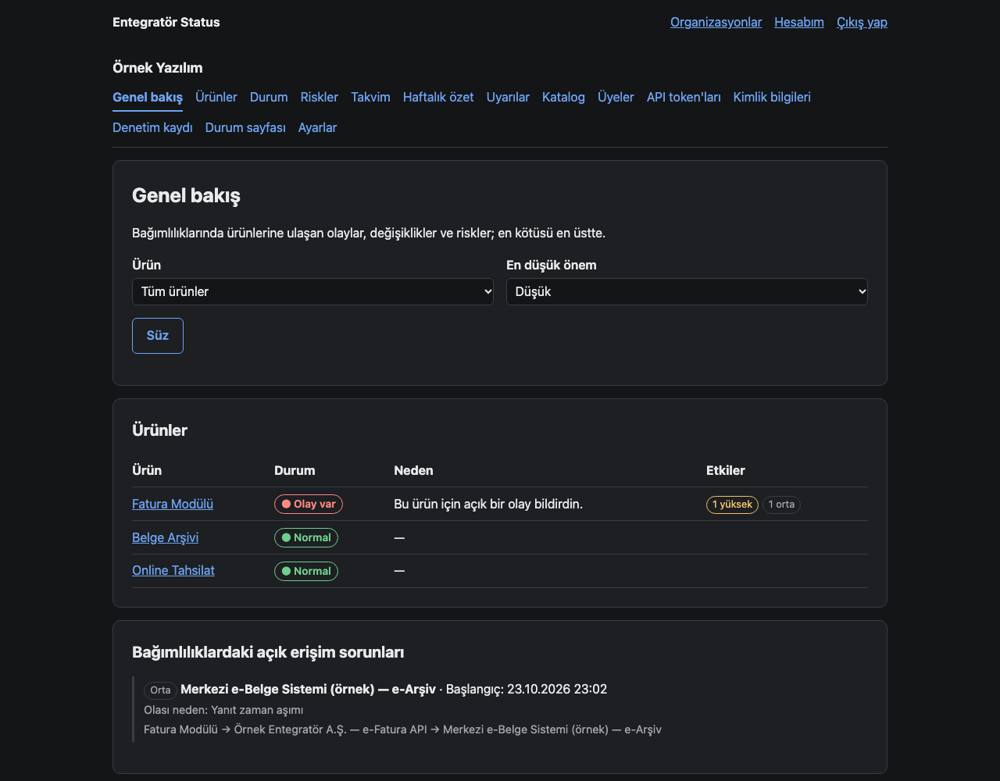
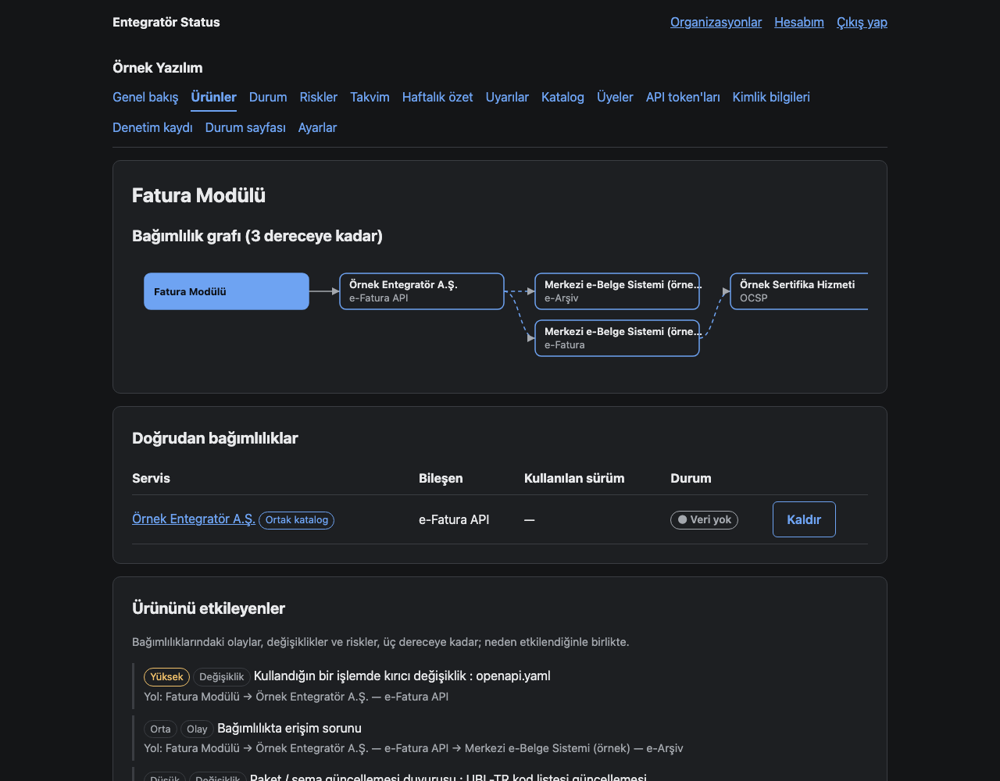
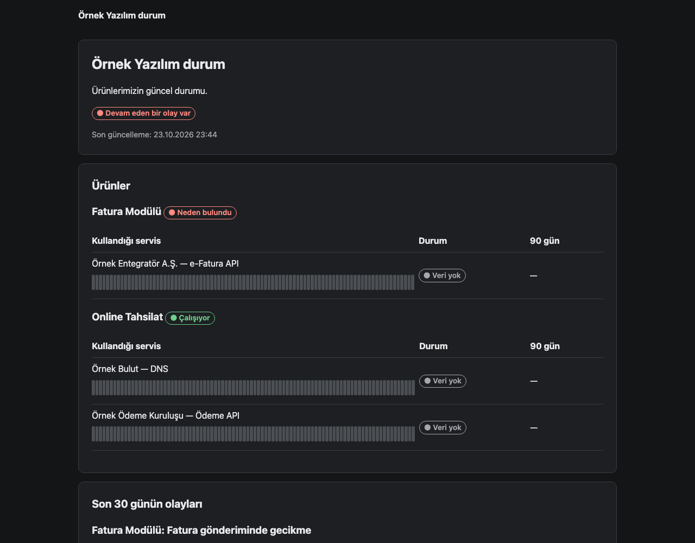
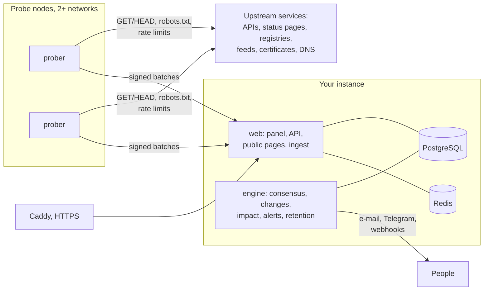

# Entegratör Status

[](https://github.com/halilibrahimd27/entegrator-status/actions/workflows/ci.yml)
[](https://github.com/halilibrahimd27/entegrator-status/releases)
[](LICENSE)

Status and change tracking for everything your product depends on — and for what
*those* depend on. Open source, self-hosted, no telemetry.

**Project site:** [halilibrahimd27.github.io/entegrator-status](https://halilibrahimd27.github.io/entegrator-status/) ·
**Latest release:** [v0.1.0](https://github.com/halilibrahimd27/entegrator-status/releases/tag/v0.1.0)
(`ghcr.io/halilibrahimd27/entegrator-status:0.1.0`, amd64 + arm64) ·
[Türkçe](#türkçe) · [Self-hosting](docs/SELF_HOSTING.md) · [Methodology](docs/METHODOLOGY.md) ·
[Changelog](CHANGELOG.md)



Map your dependencies — third-party APIs, SaaS vendors, e-invoice integrators, cloud
services, packages, container images, certificates, domains — and a curated shared
catalog adds the dependencies of those dependencies. Entegratör Status watches every
node and tells you, once and early, when something upstream breaks or changes in a way
that can break you.

1. **Is it up?** Availability from at least two independent probe locations with
   consensus, shown next to what the vendor's own status page claims.
2. **Did it change?** API contract drift (OpenAPI, JSON responses, WSDL/XSD), releases,
   security advisories, end-of-life dates, announcements and deprecation notices,
   classified by what they mean for you.
3. **Does it affect me?** Impact follows the dependency graph up to the third degree —
   *your product → your vendor → your vendor's upstream* — with the reason path and a
   severity that knows which operations you actually use.

Example: the tax authority updates the UBL-TR code lists → your e-invoice integrator has
to adapt → your invoicing module is flagged, with the effective date, before it breaks.

## What you get

- **A dashboard** with each product's derived state and why, open upstream incidents,
  recent changes, risks with a date (expiring certificates and domains, sunset headers,
  end of life, known vulnerabilities in the versions you pin) and a calendar.
- **Alerts** by e-mail, Telegram, Slack-compatible or signed webhooks
  ([WEBHOOKS.md](docs/WEBHOOKS.md)), routed by product, service, kind and severity, with
  quiet hours, daily batches and a weekly digest — one message per event and recipient.
- **Public status pages** for your own customers (`/s/<org>`): your incidents, an Atom
  feed, a badge and e-mail subscriptions — or a static copy on GitHub Pages without any
  public server ([STATIC_EXPORT.md](docs/STATIC_EXPORT.md)).
- **Authenticated checks** with your own credentials in a write-only vault, sent only to
  the host they belong to ([ADR 0011](docs/adr/0011-credentials.md)).
- **A read-only JSON API** for your own tooling (`/api/v1/products`, `/impacts`,
  `/risks`, `/calendar`, `/status`).
- **Multi-tenant** with isolation enforced by the database session itself
  ([ADR 0005](docs/adr/0005-tenant-isolation.md)); KVKK-minded retention throughout.

| Product page: the third-degree graph and what reaches it | A public status page |
|---|---|
|  |  |

Screenshots use the fictional demo data from `tools/demo.py`.

## How it works



Probe nodes are small and outbound-only; they fetch jobs from the core, make read-only
requests under strict rules (identified User-Agent, robots.txt, one request per host at a
time, back-off on 429/503 — see [the bot rules](docs/METHODOLOGY.md#how-our-bot-behaves)),
and ship signed results. The engine turns rounds from several nodes into a consensus
state ("down" needs two healthy nodes and three failed rounds), turns snapshots into
classified changes, propagates impact through the graph and sends alerts.

## Run it

**Try it locally** (Python 3.12, Docker with Compose):

```bash
make install && make env && make dev     # http://127.0.0.1:8000, mail in http://127.0.0.1:8025
docker compose run --rm --no-deps -v ./tools:/app/tools:ro web python tools/demo.py
```

The last line loads a fictional demo organization and prints a password to sign in with.

**Run your own instance** on one server with HTTPS — the short version:

```bash
git clone https://github.com/halilibrahimd27/entegrator-status.git && cd entegrator-status
git checkout v0.1.0
make env-prod                                  # .env with fresh secrets; fill in the placeholders
docker compose -f compose.prod.yml up -d       # pulls ghcr.io/halilibrahimd27/entegrator-status:0.1.0
```

The full guide — first admin, catalog, probe nodes, upgrades, monitoring — is
[docs/SELF_HOSTING.md](docs/SELF_HOSTING.md); backups and the restore drill are in
[docs/BACKUP.md](docs/BACKUP.md), probe nodes in [docs/PROBE_NODE.md](docs/PROBE_NODE.md).
Whoever runs an instance operates it; there is no hosted service and no telemetry.

## Development

| Command | What it does |
|---|---|
| `make test` | pytest against throwaway PostgreSQL/Redis (no network) and per-package coverage gates |
| `make lint` | ruff, ruff format check, mypy --strict |
| `make security` | bandit, pip-audit, gitleaks |
| `make check` | all of the above; must pass before every commit |
| `make lock` | regenerate hashed lock files (14-day release cool-down) |

```
src/sentinel/   application (accounts, tenancy, catalog, graph, probe, engine, sources,
                contracts, risk, alerts, public, admin, web, security)
tests/          pytest suite (~900 tests; real PostgreSQL and Redis, no network)
catalog/        the shared catalog as reviewed YAML packs
docs/           plan, methodology, ADRs, runbooks
```

Ground rules for contributors — tenancy, credentials, probing ethics, KVKK, security —
are in [CLAUDE.md](CLAUDE.md); decisions are recorded in [docs/adr/](docs/adr/).
Security issues: [SECURITY.md](SECURITY.md).

## How it was built

Entegratör Status was designed and reviewed by its maintainer
([@halilibrahimd27](https://github.com/halilibrahimd27)) and implemented with
[Claude Code](https://claude.com/claude-code), Anthropic's coding agent, phase by phase
along [docs/PLAN.md](docs/PLAN.md). The ground rules in [CLAUDE.md](CLAUDE.md) were
written first and bind every change; each phase ended with `make check` green (tests with
coverage gates, `mypy --strict`, bandit, pip-audit, gitleaks) and CI green, and every
non-obvious decision is an ADR. Bugs found along the way became tests first.

## License

[Apache-2.0](LICENSE) — see [NOTICE](NOTICE).

---

## Türkçe

Ürününün bağımlı olduğu her şeyin — ve onların bağımlı olduklarının — durum ve
değişiklik takibi. Açık kaynak, kendi sunucunda çalışır, telemetri yok. Proje sitesi:
[halilibrahimd27.github.io/entegrator-status](https://halilibrahimd27.github.io/entegrator-status/);
son sürüm: [v0.1.0](https://github.com/halilibrahimd27/entegrator-status/releases/tag/v0.1.0).

Bağımlılıklarını tanımla (üçüncü parti API'ler, SaaS sağlayıcıları, e-Fatura
entegratörleri, bulut servisleri, paketler, container imajları, sertifikalar, alan
adları); elle derlenen ortak katalog onların bağımlılıklarını ekler. Entegratör Status
her düğümü izler; yukarıda bir şey bozulduğunda ya da seni bozacak şekilde değiştiğinde
bir kez, erken ve nedeniyle birlikte haber verir.

- **Çalışıyor mu?** En az iki bağımsız ölçüm noktasından uzlaşmalı erişilebilirlik;
  sağlayıcının kendi durum sayfasıyla yan yana.
- **Değişti mi?** API sözleşme değişiklikleri (OpenAPI, JSON, WSDL/XSD), sürümler,
  güvenlik bildirimleri, destek bitiş tarihleri, duyurular; senin için ne anlama
  geldiğine göre sınıflandırılmış.
- **Beni etkiler mi?** Etki bağımlılık grafında üç dereceye kadar izlenir —
  *ürünün → sağlayıcın → sağlayıcının bağımlılığı* — kullandığın işlemlere göre önemle.

Örnek: GİB UBL-TR kod listelerini günceller → e-Fatura entegratörün uyum sağlamak
zorundadır → fatura modülün, yürürlük tarihiyle birlikte, bozulmadan önce işaretlenir.

Amaç; changelog okumak, durum sayfalarını takip etmek, bitiş tarihlerini elle kontrol
etmek gibi düzenli angaryayı ortadan kaldırmak ve bir bağımlılığın değişikliğiyle ürünün
bozulması gibi gözden kaçan riskleri yakalamak.

**Neler var:** ürün bazında türetilmiş durum ve nedeni; e-posta, Telegram, Slack uyumlu
ve imzalı webhook uyarıları (sessiz saatler, günlük toplu mesaj, haftalık özet);
müşterilerin için herkese açık durum sayfası (Atom, rozet, e-posta aboneliği; istersen
sunucusuz GitHub Pages kopyası); kendi kimlik bilgilerinle yetkili kontroller; salt okunur
JSON API; kurumlar arası yalıtım ve KVKK'ya uygun saklama süreleri.

**Denemek için:** `make install && make env && make dev`, ardından
`docker compose run --rm --no-deps -v ./tools:/app/tools:ro web python tools/demo.py`
(kurgusal bir demo kurum yükler ve giriş parolasını yazar).

**Kendi kurulumun için:** `git checkout v0.1.0 && make env-prod`, `.env`'deki yer
tutucuları doldur, `docker compose -f compose.prod.yml up -d`. Ayrıntılar
[docs/SELF_HOSTING.md](docs/SELF_HOSTING.md)'de — tek sunucu,
Caddy ile otomatik HTTPS, yedekleme ve geri yükleme tatbikatı, ölçüm noktaları. Kurulumu
çalıştıran taraf onu işletir ve KVKK kapsamında veri sorumlusudur; barındırılan bir servis
ya da telemetri yoktur.

**Nasıl geliştirildi:** Bakımcı ([@halilibrahimd27](https://github.com/halilibrahimd27))
tarafından tasarlandı ve gözden geçirildi; Anthropic'in kodlama ajanı
[Claude Code](https://claude.com/claude-code) ile [docs/PLAN.md](docs/PLAN.md)'deki
aşamalar sırasıyla uygulandı. Her aşama `make check` (testler, kapsam eşikleri,
`mypy --strict`, bandit, pip-audit, gitleaks) ve CI yeşilken kapandı; kararlar ADR olarak
kayıtlı.

Lisans: [Apache-2.0](LICENSE).
